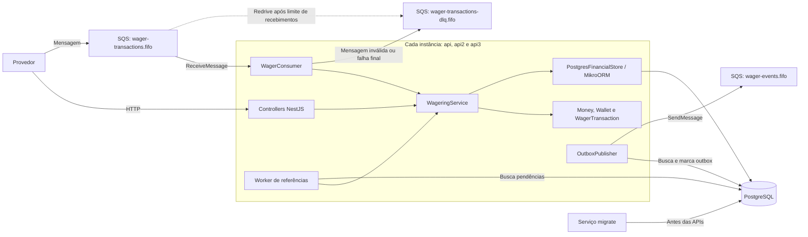
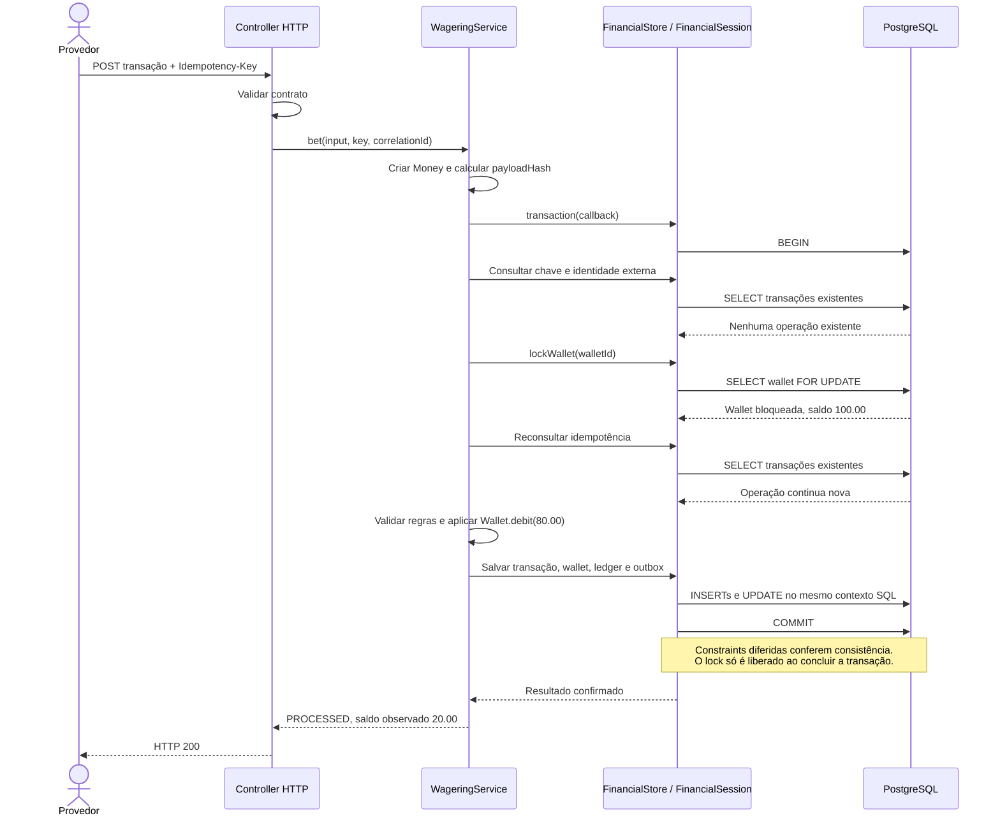
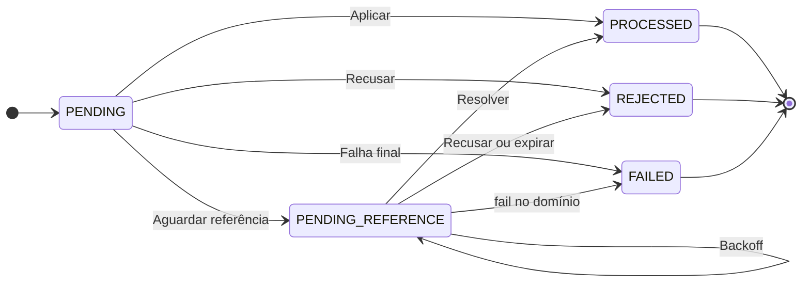
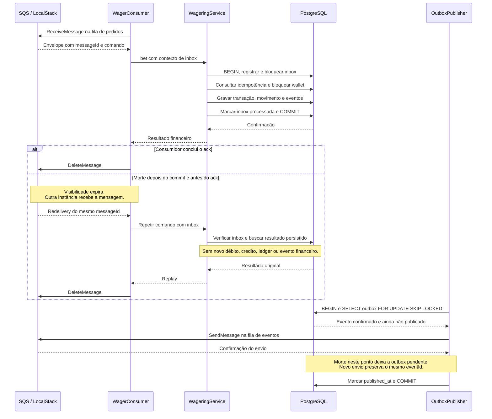
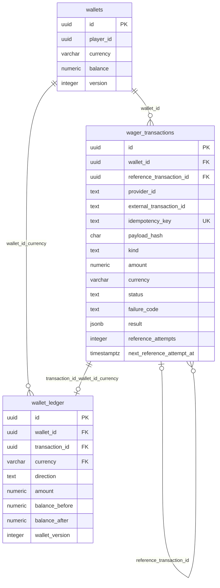
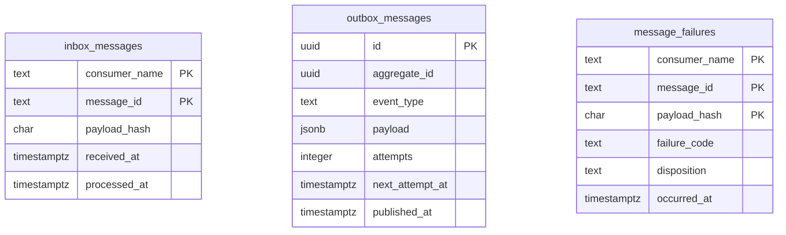

# Decisões de arquitetura

## Componentes

Cada uma das três instâncias executa HTTP e os mesmos workers. O banco coordena concorrência e idempotência entre os processos; as filas são compartilhadas.

As três filas são emuladas pelo LocalStack. A fila de eventos é a saída para aplicações externas; este serviço não mantém um consumidor contínuo desses eventos.

## Organização e dinheiro

O domínio contém Money, Wallet, WagerTransaction, ledger e eventos, sem decorators de NestJS ou tipos monetários do ORM. A aplicação coordena as regras por FinancialStore; a infraestrutura implementa persistência e SQS. Factories criam e reidratam entidades, mantendo transições explícitas e estado encapsulado.

Money é imutável e usa decimal.js com precisão de 40 dígitos. O contrato aceita string não negativa com exatamente duas casas, sem arredondamento implícito. A persistência usa NUMERIC(20,2), lido como string, e moeda em coluna separada. Entradas e resultados além da capacidade dessa coluna são rejeitados. Operações entre moedas diferentes falham; resultados internos assinados são permitidos para reconciliação.

## Persistência e concorrência

MikroORM usa EntitySchema e WalletRecord separado da Wallet de domínio. DecimalType('string') preserva valores monetários exatos. Cada trabalho usa EntityManager.fork().transactional(), evitando compartilhar o contexto de entidades entre requisições. A wallet usa entidades gerenciadas e flush explícito; ledger, transações, inbox e outbox usam SQL parametrizado no mesmo EntityManager transacional.

O lock pessimista é por wallet, antes de aplicar o movimento. Uma carteira disputada processa operações em sequência; carteiras diferentes não compartilham um lock global. Statement timeout de 10s e lock timeout de 5s limitam esperas. A versão começa em 1 e só aumenta quando o saldo muda; o controle de concorrência principal é o lock, não a versão.

Idempotência é consultada antes e depois do lock. Constraints únicas protegem player/moeda, chave e provider/ID externo, inclusive disputas entre wallets diferentes. A inserção usa ON CONFLICT DO NOTHING; se perder a disputa, busca o resultado confirmado e retorna replay ou conflito sem salvar a alteração financeira local.

Saldo, transação, ledger, inbox da entrada SQS e outbox confirmam juntos. OPENING positivo é interno e cria crédito de abertura na mesma transação; abertura zero não cria movimento. Toda movimentação gera um lançamento; LOSS e rejeições não geram ledger.

Checks e triggers validam saldo não negativo, aritmética, identidade/moeda, sequência de versões e correspondência entre transação e ledger. Triggers diferidos conferem a consistência no commit. UPDATE, DELETE e TRUNCATE do ledger são bloqueados. Transições de operações terminais são bloqueadas no domínio e no banco.

O custo dessa proteção é percorrer o histórico da wallet para conferir saldo a cada movimento. Históricos grandes exigem avaliar validação incremental. O usuário local de bootstrap é administrador; em produção, a aplicação precisaria de usuário restrito, sem permissão para desabilitar triggers.

As migrations são versionadas com up/down e executadas antes das APIs. A reversão de operações estendidas recusa downgrade com registros incompatíveis, em vez de descartar esses registros silenciosamente.

### Processamento de uma aposta

Caminho de uma BET nova e aprovada. A consulta de idempotência é repetida depois do lock porque outra instância pode ter confirmado o pedido durante a espera. Replays retornam o resultado salvo; rejeições e LOSS não fazem as escritas de saldo/ledger mostradas neste caminho.

## Idempotência, estados e reversões

Idempotency-Key é obrigatória e globalmente única. A identidade externa é única por provider. Mesmo corpo e chave retornam o resultado salvo com idempotentReplay=true; chave divergente para a mesma identidade externa ou mesma chave com outro corpo geram conflito.

O payloadHash é SHA-256 de JSON canônico com ordenação recursiva de chaves, após normalização de UUIDs e Money. Headers e correlação não entram no hash financeiro; campos desconhecidos são rejeitados. O resultado guarda o saldo observado na operação, preservado no replay mesmo que a wallet mude depois.

Estados: PENDING é inicial; PENDING_REFERENCE aguarda referência; PROCESSED, REJECTED e FAILED são terminais. Só estados pendentes aceitam conclusão ou rejeição. Repetir uma operação terminal retorna seu resultado, sem reabrir processamento.

REFUND exige BET processada. ROLLBACK aceita BET, WIN ou REFUND processados e inverte a direção original. A referência é resolvida por provider/ID externo e deve compartilhar player, wallet, moeda e rodada. O valor da reversão deve ser igual ao original. WIN aceita referência opcional a BET; BET/LOSS não aceitam referência e auto-referência é inválida.

Índice único parcial limita reversões processadas por referência e tipo. REFUND e ROLLBACK distintos podem reverter a mesma BET uma vez cada. Reversão rejeitada não consome esse limite, mas a operação rejeitada permanece terminal. Não há exclusividade adicional de WIN/LOSS por rodada.

Referência ausente ou pendente gera PENDING_REFERENCE sem mover saldo. Worker roda a cada segundo, busca até 50 pendências vencidas e reprocessa pelo mesmo caso de uso. Sob lock, relê estado e prazo para impedir aplicação por dois workers. Backoff começa em 2s e limita em 5min; TTL de 24h acomoda atrasos prolongados com encerramento finito. Ao expirar, registra REJECTED/REFERENCE_EXPIRED e evento. Tentativas e próximo prazo ficam no banco; retries ainda pendentes não repetem o evento inicial.

Códigos de contrato: INVALID_PAYLOAD, INVALID_AMOUNT, INVALID_CURRENCY, AMOUNT_OUT_OF_RANGE, INVALID_MOVEMENT_AMOUNT, INVALID_KIND, INVALID_PROVIDER, REFERENCE_REQUIRED, REFERENCE_NOT_ALLOWED e SELF_REFERENCE. Conflitos: IDEMPOTENCY_CONFLICT e WALLET_ALREADY_EXISTS. Rejeições financeiras: INSUFFICIENT_FUNDS, CURRENCY_MISMATCH, PLAYER_MISMATCH, REFERENCE_NOT_PROCESSED, REFERENCE_IDENTITY_MISMATCH, INVALID_REFERENCE_KIND, REFERENCE_AMOUNT_MISMATCH, REFERENCE_ALREADY_REVERSED e REFERENCE_EXPIRED. Reversão sem saldo usa REVERSAL_INSUFFICIENT_FUNDS, distinto de aposta sem saldo. Falha transitória HTTP retorna 503/INFRASTRUCTURE_UNAVAILABLE; falha interna/permanente retorna 500/INTERNAL_PROCESSING_ERROR. Replay de FAILED retorna 500 com seu resultado auditável.

### Estados da transação

Transições permitidas pela entidade. FAILED representa uma conclusão de infraestrutura registrada, enquanto REJECTED representa recusa de negócio. Estados terminais não têm transição de saída para outro estado de negócio.

O worker de referências conclui pendências como PROCESSED ou REJECTED. O caminho de falha final do consumidor não converte uma operação já existente em FAILED; ele preserva a operação encontrada e sua idempotência.

## Mensagens e eventos

HTTP e SQS usam WageringService. A inbox tem chave consumer_name/message_id do envelope da aplicação. Seu hash inclui comando e idempotencyKey, excluindo metadados de transporte. Inserção e lock da inbox detectam conteúdo divergente; processed_at é confirmado junto do efeito financeiro. A idempotência financeira continua protegendo a operação mesmo quando chegam mensagens diferentes.

Filas locais: wager-transactions.fifo, wager-transactions-dlq.fifo e wager-events.fifo. O consumidor recebe até 10 mensagens com long polling de 1s, visibilidade de 30s e heartbeat a cada 10s. DeleteMessage ocorre após commit. Rejeição financeira recebe ack; conflito de chave/inbox ou wallet inexistente recebe ack com auditoria em message_failures. Contratos inválidos e falhas permanentes vão para DLQ.

Falhas transitórias recebem backoff de visibilidade exponencial, limitado a 60s, com máximo de 5 recebimentos. O broker também tem redrive de 5 como proteção adicional. Para comando válido, falha permanente ou exaustão registra FAILED, inbox e evento atomicamente, sem ledger, se o banco estiver disponível. Se o banco continuar indisponível, deixa a mensagem sem ack para redrive. Falha no ack após commit nunca converte a operação em FAILED.

Eventos usam subclasses de IntegrationEvent com tipo e versão declarados, eventId estável, correlação e data ISO. Dados monetários são DTOs com strings. Processed inclui LOSS; BalanceChanged só existe quando o saldo muda; rejeição e pendência têm eventos próprios.

Outbox é gravada no mesmo commit financeiro. Publishers buscam linhas com FOR UPDATE SKIP LOCKED, enviam e marcam published_at após confirmação. O lock fica aberto durante a rede: simplifica concorrência/recuperação, com custo de manter transação SQL durante o envio. SDK faz uma tentativa com timeout de 5s; backoff persistido começa em 2s e limita em 60s. Falhas não apagam eventos nem esgotam sua intenção de publicar.

Morte após envio e antes da marcação pode repetir o evento. MessageGroupId usa walletId e deduplicação FIFO usa eventId; o destinatário ainda precisa de inbox persistente por eventId. FIFO é uma otimização, não a garantia final. Eventos também podem chegar fora de ordem; BalanceChanged inclui walletVersion.

No shutdown, workers param novos agendamentos, polls são abortados e trabalho em andamento é aguardado antes de fechar ORM/SQS. Promise.allSettled mantém todos os handlers do lote nessa espera mesmo quando um falha. Compose usa init e prazo de 30s para encerramento.

### Inbox, commit, ack e publicação

O commit financeiro e o envio ao broker são etapas separadas. A inbox participa da primeira; o publisher recupera a outbox já confirmada na segunda.

O diagrama mostra a ordem necessária dentro de cada fluxo. O publisher pode publicar o evento antes ou depois do ack de entrada, desde que o commit financeiro já tenha ocorrido. As chamadas SQL do serviço passam pela implementação de FinancialStore.

## Modelo de dados

Relações físicas principais e campos usados nas garantias financeiras. Os tipos monetários abaixo correspondem a NUMERIC(20,2).

As tabelas de mensageria e auditoria são independentes das FKs financeiras:

Inbox e auditoria identificam a mensagem sem FK para uma transação financeira. A outbox usa aggregate_id para identificar a wallet e transactionId no JSON do evento, sem FK nessas associações. Por isso essas tabelas aparecem sem linhas de relacionamento físico.

Além das chaves mostradas, há uniques compostas em player/moeda, provider/ID externo, transação/wallet e wallet/versão do ledger. O índice parcial de reversões é único por reference_transaction_id/kind somente para operações processadas. Uma transação tem no máximo um lançamento; LOSS, rejeições, pendências e falhas não têm lançamento.

## Consultas e observabilidade

Reconciliação compara saldo e soma do ledger em um único SELECT, com o mesmo snapshot MVCC. difference = armazenado - calculado. Divergência gera resposta, log e métrica; não faz reparo automático.

Ledger pagina por wallet_version. O cursor assinado com HMAC-SHA256 contém wallet, posição e versão máxima da primeira página. Assim, inserções novas não alteram aquela navegação. O cursor não é autorização; a chave deve ser igual entre instâncias, e rotação invalida cursors antigos.

Liveness verifica processo; readiness verifica PostgreSQL e SQS. Logs JSON incluem os IDs conhecidos de correlação, mensagem, transação, wallet e provider, sem valores monetários, corpo, senhas ou tokens. Métricas têm labels limitadas, sem IDs de jogador ou transação. Contadores/histogramas são por processo; gauges do banco e profundidade aproximada da DLQ representam fontes compartilhadas e não devem ser somados entre réplicas.

## Autenticação

Autenticação externa não foi implementada para priorizar correção financeira e recuperação de falhas. ProviderIdentityGuard no-op é o ponto de extensão. A implementação futura usaria IdP externo, validação OIDC e vínculo da identidade autenticada ao providerId. Health continua público; mensagens são um canal interno confiável, mas passam pelas mesmas validações de domínio.

## Ambiente e validação

Compose executa três APIs independentes, PostgreSQL, LocalStack e uma migration one-shot. Docker usa Bun com frozen lockfile e usuário sem root; dependências de desenvolvimento permanecem na imagem para typecheck e testes.

Os testes usam bancos dedicados e filas temporárias. Cobrem regras monetárias, migrations/constraints, atomicidade, 50 duplicatas, disputa de saldo, três processos, referências fora de ordem, dois publishers, retry/DLQ, morte após commit/antes de ack e morte após envio/antes da marcação. Também exercitam reconciliação concorrente, corrupção deliberada sem reparo e espera de shutdown. O smoke distribuído verifica estado após reinício das APIs.

Não houve teste de carga; não há alegação de throughput ou prontidão de produção. Dashboard, tracing e partidas dobradas não foram implementados. LocalStack usa filas efêmeras: reinício pode perder mensagens do broker. Provisionamento periódico de 30s recupera as filas, mas só os eventos ainda pendentes na outbox têm recuperação garantida pelo PostgreSQL nesse ambiente.
